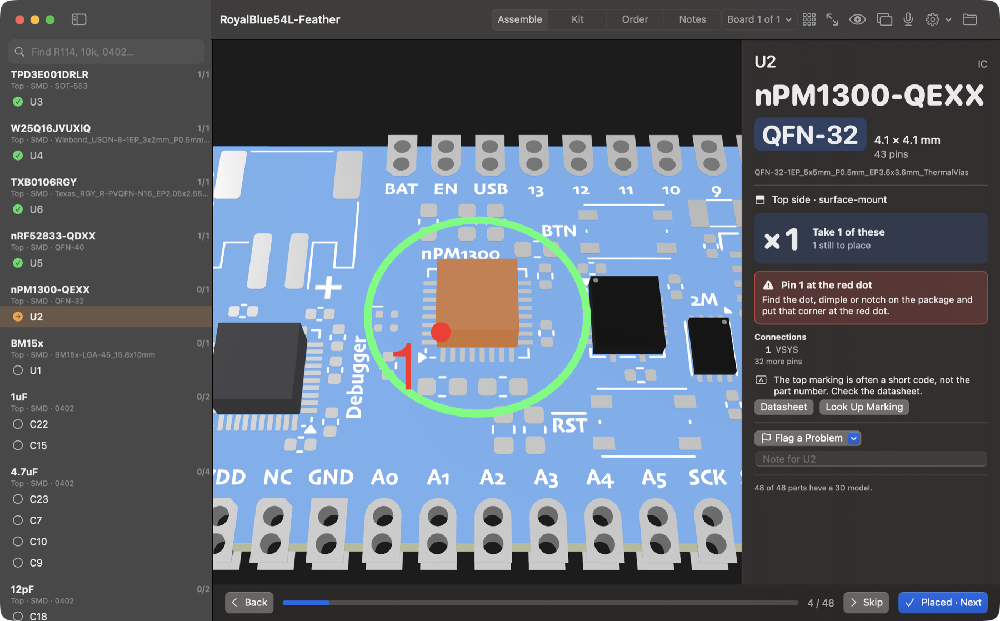
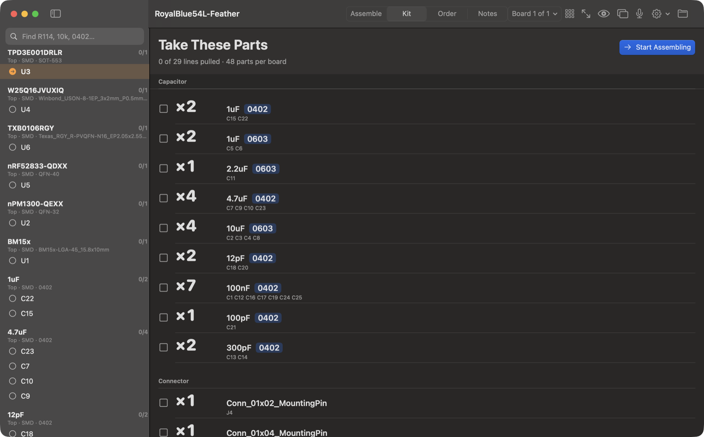
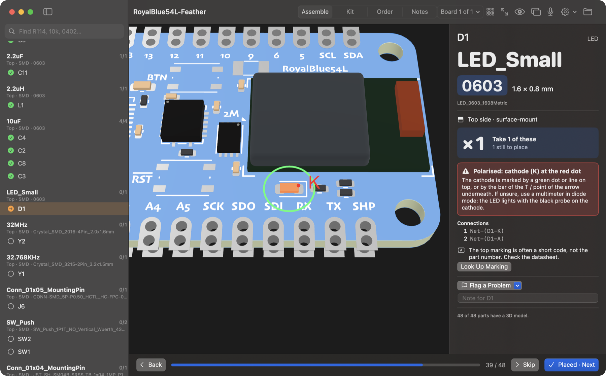
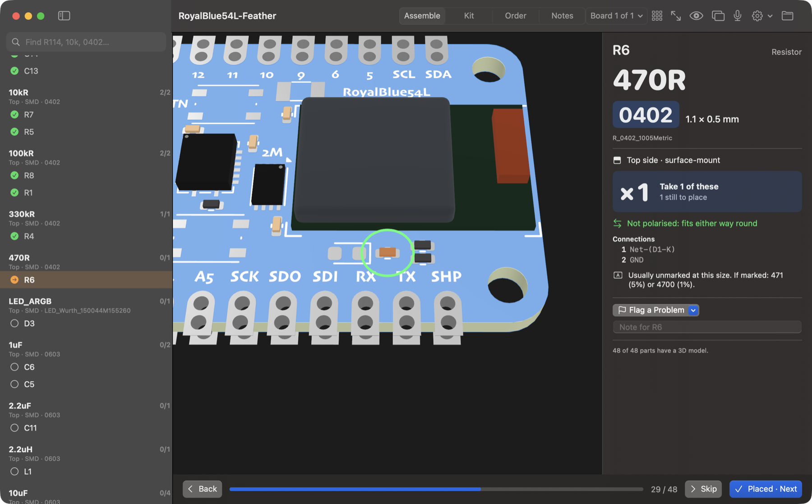
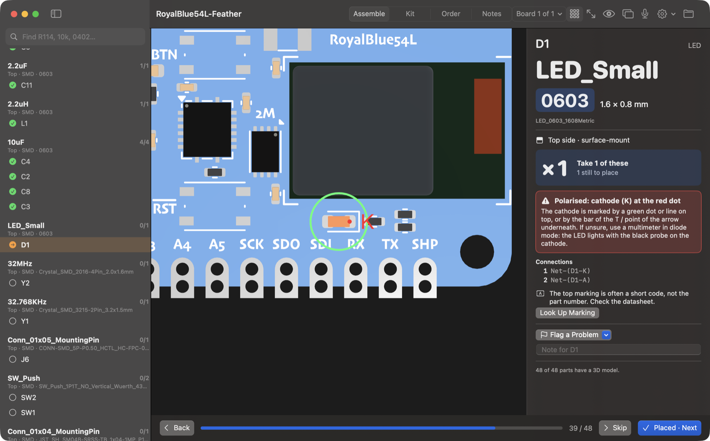
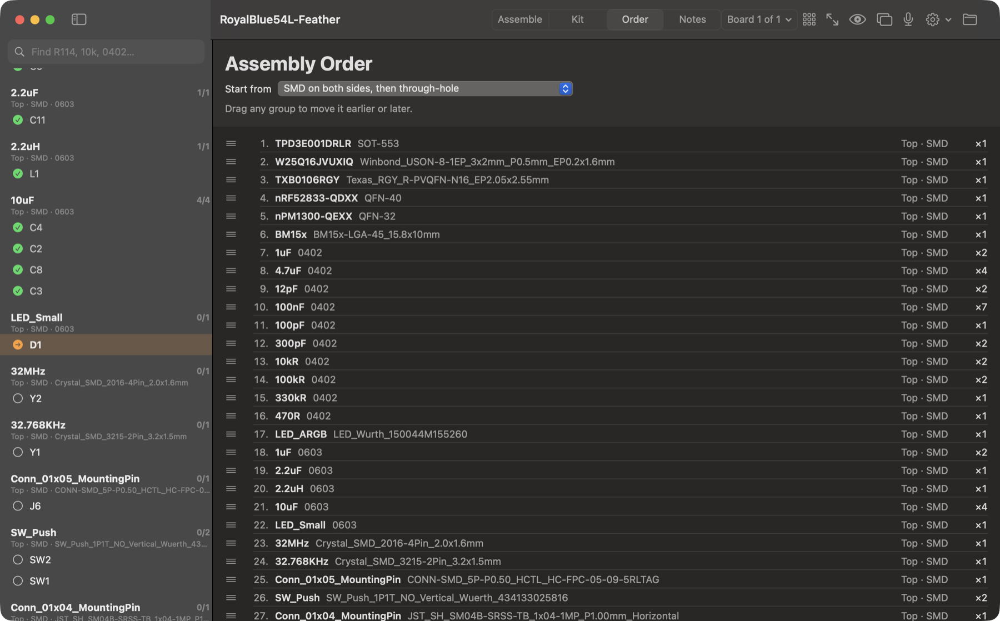
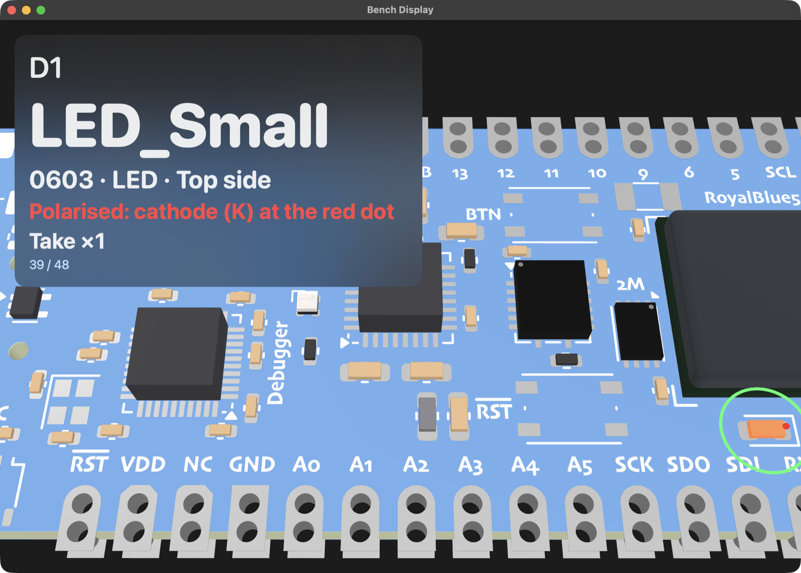
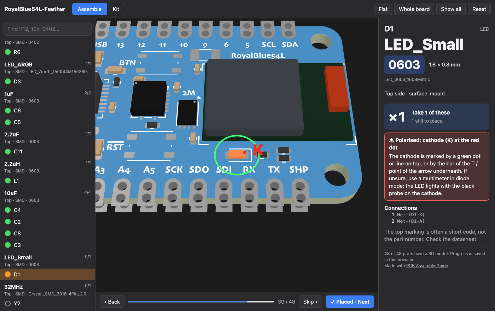
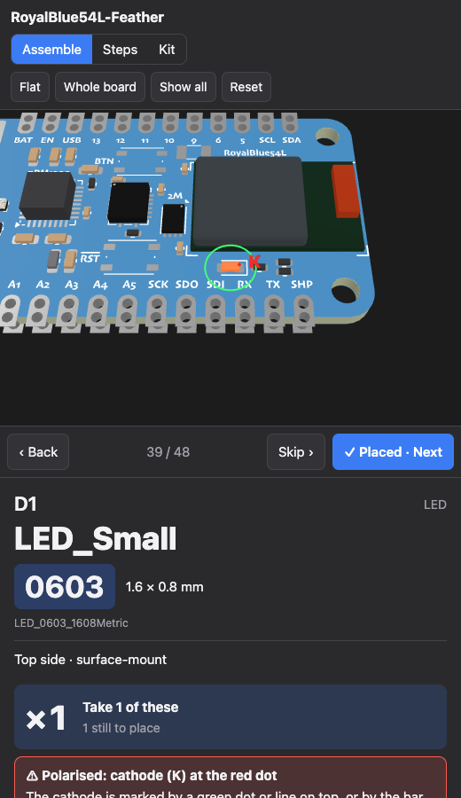

<h1 align="center">PCB Assembly Guide</h1>

<p align="center">
  A Mac app that walks you through hand-soldering a KiCad board, one part at a time, on a 3D view of the real board.
</p>

<p align="center">
  
  
  
  <a href="LICENSE"></a>
</p>



Open a `.kicad_pcb` file and the app shows you which part to pick up, where it goes and which way round. Press Space when it is soldered and it moves to the next one.

It reads the board file directly, so there is no BOM export, plugin or position file to prepare. It never writes to your KiCad project.

## Features

- **3D board, one part at a time.** The board is rendered with KiCad's own 3D models. The part to place is ringed in green and the camera moves to it. Parts already soldered stay on the board, so the screen matches what is on your bench.
- **Big value and package.** The value (`470R`, `100nF`) and size (`0402`, `QFN-32`) are shown large enough to read from across the bench, with the body dimensions in millimetres.
- **Polarity and pin 1.** Diodes, LEDs, polarised capacitors and ICs get a red dot on the board at the cathode, positive pad or pin 1, plus a plain-language note on how to find that mark on the part. Parts that fit either way round say so.
- **Kit list first.** A new board opens on a pick list with the quantity of every value, so you can take the right number of each part before you start.
- **Sensible order.** Surface-mount before through-hole, ICs first, then small to large. Identical parts are grouped and walked in a short path across the board. Pick another preset or drag groups into your own order.
- **Flat view.** A top-down view that matches the silkscreen drawing, for when the perspective view is harder to read.
- **Both sides.** The board turns over for bottom-side parts.
- **Marking hints.** Shows the code printed on a resistor (`471`, `4700`) and warns when a part is normally unmarked.
- **Jumper links.** For three-pad solder jumpers with a value such as `0R (pads 2-3)`, the two pads to bridge are highlighted.
- **Connections.** Lists the nets on each pad, so you can check a joint with a multimeter.
- **Search and click.** Find any part by reference, value or package, or click it on the 3D board to jump to it.
- **Notes and flags.** Mark a part as out of stock, needing rework or substituted, and review them all on the Notes tab.
- **Several boards.** Build a batch from one design. Progress and notes are kept per physical board.
- **Bench display.** A second window with very large type for a spare monitor.
- **Hands-free stepping.** Space, Return, arrow keys and Page Up/Down all work, so a foot pedal or presenter clicker does too.
- **Voice control (experimental).** Say "next", "back" or "skip". This has had little testing; please report problems.
- **Progress is saved.** Close the app mid-board and it reopens where you stopped.
- **Web guide export.** Save the whole guide as one HTML file and send it to anyone. It opens in any browser on any device, with no app and no KiCad. See [Sharing a guide](#sharing-a-guide).

## Screenshots

| | |
|---|---|
|  **Kit** shows how many of each part to take |  **Polarity** marks the cathode in red |
|  **Resistors** show the printed code |  **Flat view** matches the silkscreen |
|  **Order** can be rearranged by dragging |  **Bench display** for a second screen |

The board in the screenshots is the [RoyalBlue54L Feather](https://github.com/Lords-Boards/RoyalBlue54L-Feather) by Lord's Boards, one of KiCad's demo projects, released under CERN-OHL-P v2.

## Requirements

- macOS 14 (Sonoma) or later.
- [KiCad](https://www.kicad.org/download/macos/) installed in `/Applications`. The app uses KiCad's `kicad-cli` to export the board's 3D model and reads KiCad's standard 3D model library. It was developed against KiCad 10.
- To build: the Swift toolchain, either from Xcode or the Command Line Tools (`xcode-select --install`). Xcode itself is not needed.

Without KiCad the app still opens a board and guides you through it, but it draws a plain slab with boxes for the parts.

## Build and install

```sh
git clone https://github.com/vpkrishnakumar/pcb-assembly-guide.git
cd pcb-assembly-guide
./build.sh install
```

`./build.sh` builds `build/PCB Assembly Guide.app`. Adding `install` also copies it to `/Applications`.

The app is ad-hoc signed. If you copy a build to another Mac, right-click it and choose Open the first time.

## Using it

1. Open a `.kicad_pcb` file with the folder button, **File > Open Board…** (⌘O), or by dragging it onto the window. The first load takes a few seconds while KiCad exports the 3D model. Later loads use a cache.
2. On the **Kit** tab, take the listed quantity of each part and tick each line off. Then choose **Start Assembling**.
3. On the **Assemble** tab, place the ringed part and press Space. Repeat.

### Keys

| Key | Action |
|---|---|
| Space, Return, Page Down | Part placed, go to the next |
| ←, Page Up | Go back one part |
| → | Skip this part for now |
| ⌘1 to ⌘4 | Assemble, Kit, Order, Notes |
| ⇧⌘F | Flat view |
| ⌘B | Bench display |
| ⇧⌘E | Export web guide |
| ⌘O | Open a board |

Drag on the 3D view to orbit, scroll to zoom, and click a part to jump to it.

### Sharing a guide

**File > Export Web Guide…** (⇧⌘E) writes a single `.html` file containing the 3D board, the step-by-step plan, the kit list and the polarity notes. Email it, put it on a shared drive or host it anywhere. The person building the board opens it in a browser on a Mac, Windows or Linux PC, a tablet or a phone. Nothing is installed and the page works offline.

| Desktop browser | Phone |
|---|---|
|  |  |

The page has the Assemble and Kit views, search, click-to-jump, flat view and the same keys as the app. Progress is saved in that browser. Notes, batches of several boards, custom ordering and voice control are only in the Mac app.

The file is usually 5 to 15 MB, because the board's 3D model is inside it. The 3D view uses [three.js](https://threejs.org) (MIT), which is bundled into the page.

From the command line:

```sh
.build/release/PCBAssemblyGuide --export-web board.kicad_pcb guide.html
```

### What gets assembled

Footprints marked *Do not populate*, *Exclude from BOM* or *Board only* are left out, as are footprints with no pads.

### Parts without a 3D model

If a two-pad resistor, capacitor, inductor, ferrite, diode or LED has no 3D model assigned, the app borrows the matching model from KiCad's standard library, working on a private copy of the board. Other parts without a model are drawn as boxes the size of their footprint. You can turn the borrowing off under the gear menu.

## How it works

1. **Parse.** `SExpr.swift` and `KiCadBoard.swift` read the `.kicad_pcb` S-expressions into components with their position, side, pads, nets and schematic pin functions.
2. **Work out polarity.** The cathode, positive pad or pin 1 comes from the schematic pin function stored on each pad (`K`, `A`, `+`), falling back to pad 1.
3. **Export.** `BoardLoader.swift` runs `kicad-cli pcb export glb` and caches the result in `~/Library/Caches/PCBAssemblyGuide`. KiCad names each node in the export after its reference, which is how the app can show and hide individual parts.
4. **Render.** `GLB.swift` loads the export into SceneKit, and `BoardScene.swift` handles visibility, the highlight ring, the polarity marker and the camera.
5. **Plan.** `AssemblyPlan.swift` groups and orders the parts.

The interface is SwiftUI (`Views.swift`) driven by one observable model (`AppModel.swift`). The app itself has no third-party dependencies. The exported web guide (`WebExport.swift`, `Resources/web/guide.html`) inlines three.js.

### Command-line mode

The binary can render a step without opening a window, which is useful for checking a board:

```sh
.build/release/PCBAssemblyGuide --snapshot board.kicad_pcb out.png 12          # step 12
.build/release/PCBAssemblyGuide --snapshot board.kicad_pcb out.png U3 --flat   # the step for U3, flat view
.build/release/PCBAssemblyGuide --snapshot board.kicad_pcb out.png all --list  # whole board, and print the plan
```

## Known limitations

- Polarity comes from the schematic and footprint, not from the physical part. Always confirm against the datasheet for anything expensive or unfamiliar. In particular, a TVS diode drawn with a cathode in the schematic is marked as polarised even if the fitted part is bidirectional.
- Switches and some connectors get no orientation mark.
- IC top markings are not predicted; the app links to the datasheet instead.
- Voice control is experimental.
- Developed and tested on Apple Silicon with KiCad 10 only.

## Contributing

Issues and pull requests are welcome. If a board loads wrongly, a small `.kicad_pcb` that reproduces it helps most.

Note for contributors building without Xcode: the Command Line Tools do not ship the SwiftUI macro plugin, so `@State` does not compile. View state lives in `AppModel` as `@Published` properties for that reason.

## Licence

[MIT](LICENSE).

KiCad is a trademark of the KiCad project. This app is not affiliated with or endorsed by KiCad.
